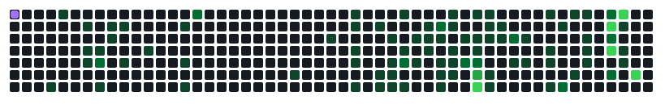

---

## 👨‍💻 About

I'm a student at **ABV-IIITM Gwalior** (Integrated B.Tech in IT + MBA, 2024–2029, CGPA 8.1) who likes shipping things end to end, from React and Angular front ends to FastAPI back ends and sandboxed AI systems.

- 🏢 **Former SDE Intern at Inforida Technologies** (Jun–Sep 2026, remote): worked on **Nucleus**, a school-management platform serving 250+ schools, with Angular, TypeScript and REST APIs. Contributed to the Exam module (UI and API integration) and fixed a bug that mismatched WhatsApp message counts in the Communication module.
- 🔬 Part of the team that built **ReRun**, an autonomous agent that checks whether published ML research code reproduces its headline results.
- 🧠 Part of the team behind **Aparichit**, a machine-unlearning toolkit and benchmark for language models.
- 🎯 Led **Hackatron**, a 36-hour national-level hackathon at Infotsav.

---

## 🚀 Featured Projects

<table>
<tr>
<td width="33%" valign="top">

### 🧬 [Aparichit](https://github.com/Suryanshu-01/aparichit)
**Machine-unlearning toolkit and benchmark for language models**

A team project that asks how close approximate unlearning can bring a fine-tuned model to one that never saw the data, and what each method costs in retained knowledge and fluency.

- Four methods compared: Gradient Difference, Fisher Forgetting, Task Vector Negation and Generic-Label Fine-Tuning
- Strict 85/10/5 retain/forget/unseen split on the TOFU benchmark with GPT-2 small
- Scored against a retain-only reference model with forget quality (KS test) and membership-inference audits
- Reusable Python library with a CLI, test suite and a benchmark leaderboard

</td>
<td width="33%" valign="top">

### 🔁 [ReRun](https://github.com/Suryanshu-01/ReRun)
**Reproducibility agent for ML research code**

A team project: an autonomous agent that checks whether published ML code reproduces its headline results.

- 20-phase state machine with hard limits on steps, patch attempts and runtime
- Hardened Docker sandboxes: no network, non-root, read-only filesystem, CPU/memory caps
- Solver–Critic LLM design under a deterministic policy engine and 3 human approval gates; all 9 adversarial tests pass
- SHA-256 evidence ledger and exportable reproduction kits
- React + TypeScript console with live SSE telemetry over FastAPI; 319 automated tests

</td>
<td width="33%" valign="top">

### 🏥 [MediCompare](https://github.com/Suryanshu-01/MediCompare)
**Healthcare discovery platform**

A full-stack platform, deployed on Vercel and Render, to find nearby hospitals on a Mapbox map and compare doctors, services and test costs.

- JWT role-based auth for patients, hospitals and admins, with admin verification of hospital documents
- Hospital dashboard to add, activate/deactivate and update doctors and services
- 1–10 doctor ratings feed hospital scores
- Compare 2–4 doctors side by side with a Smart Score (rating, experience, qualification, availability, fees)

</td>
</tr>
</table>

---

## 🛠️ Tech Stack

 
 
 

| | |
|---|---|
| **Languages** | C++, C, JavaScript, TypeScript, Python, Dart |
| **Frontend** | ReactJS, Angular, Flutter, Tailwind CSS |
| **Backend & Databases** | Node.js, Express.js, FastAPI, REST APIs, MongoDB, MySQL, SQLite, Firebase Firestore |
| **Tools** | Git, GitHub, Docker, Mapbox, Cloudinary, Figma |
| **Core CS** | Data Structures, Algorithms, OOPs, DBMS, Computer Networks, Operating Systems |

---

## 📊 GitHub Stats

---

## 🐍 Contribution Snake

<picture>
  <source media="(prefers-color-scheme: dark)" srcset="https://raw.githubusercontent.com/Suryanshu-01/Suryanshu-01/output/github-snake-dark.svg"/>
  <source media="(prefers-color-scheme: light)" srcset="https://raw.githubusercontent.com/Suryanshu-01/Suryanshu-01/output/github-snake.svg"/>
  
</picture>

---

**Open to collaborations. Reach out on [LinkedIn](https://linkedin.com/in/suryanshu01) or [email](mailto:suryanshu01.dev@gmail.com).**

